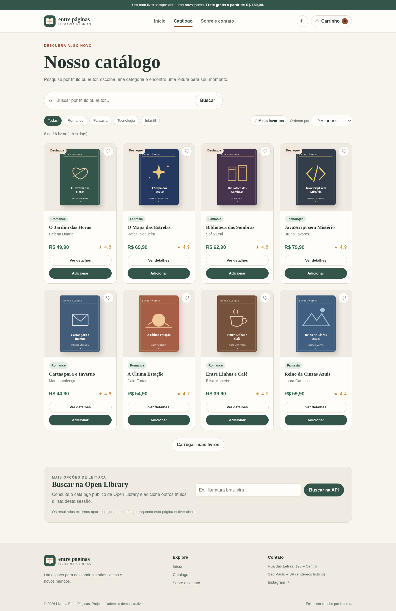

# Livraria Entre Páginas

Projeto acadêmico de uma livraria, desenvolvido para a atividade final de Desenvolvimento Web.

**Integrantes:** Lucas Souza e Renan Martins.

O site reúne página inicial, catálogo, detalhes dos livros, carrinho de compras, checkout demonstrativo e formulário de contato. Foi desenvolvido com HTML5, CSS3 e JavaScript puro.

> **Importante:** este projeto é uma demonstração acadêmica. Os livros locais, preços, endereço, contatos e pedido são fictícios. Nenhum pagamento é processado e nenhum formulário envia informações para um servidor. No formulário de cartão, use somente dados inventados. Não informe dados de um cartão verdadeiro.

## Como executar

1. Extraia o projeto e abra a pasta `livraria-entre-paginas` no Visual Studio Code.
2. Inicie um servidor local pela extensão **Live Server**.
3. Abra `index.html` pelo Live Server.

Não é necessário instalar pacotes, usar `npm` ou executar uma etapa de compilação. A conexão com a internet é usada para consultar a Open Library, consultar CEPs no ViaCEP e carregar as fontes externas. O catálogo local continua disponível sem essas conexões.

## Funcionalidades

### Catálogo e navegação

- Página inicial com logotipo, menu, banner de destaque, livros selecionados e rodapé.
- Catálogo dinâmico com 16 livros locais, distribuídos em quatro categorias: Romance, Fantasia, Tecnologia e Infantil.
- Cards com capa, título, autor, categoria, preço e avaliação.
- Tela de detalhes com sinopse e informações bibliográficas.
- Busca por título ou autor, filtro por categoria, ordenação e paginação.
- Favoritos e avaliações por estrelas, salvos no navegador.

### Carrinho e compra demonstrativa

- Adicionar, remover e alterar a quantidade dos livros.
- Cálculo de subtotal, frete, desconto e total.
- Cupom `LIVRO10`, que aplica 10% de desconto sobre o subtotal.
- Carrinho persistido no `localStorage`, mesmo depois de atualizar a página.
- Consulta de CEP pelo ViaCEP e preenchimento automático do endereço.
- Escolha de Pix, cartão de crédito ou boleto em uma etapa de pagamento demonstrativa.

### Recursos complementares

- Tema claro e escuro, com preferência salva no navegador.
- Busca opcional na Open Library, cujos resultados são incluídos no catálogo e armazenados no navegador.
- Formulário de contato com validação local e mensagem de retorno na própria página.
- Layout responsivo para computador e celular.

## Pagamentos: somente simulação

O checkout apresenta três opções para demonstrar diferentes estados de interface:

- **Pix:** exibe um QR Code cenográfico. Ele contém apenas uma mensagem de demonstração, não é um código Pix válido e não permite transferências.
- **Cartão de crédito:** mostra os campos de número (16 dígitos), nome do titular, validade (`MM/AA`) e CVV (3 ou 4 dígitos). A validação é apenas de formato e validade da data. Os dados não são enviados nem armazenados e são apagados ao concluir o pedido ou trocar de forma de pagamento. Use somente informações inventadas.
- **Boleto:** mostra uma explicação, mas não cria boleto, linha digitável ou cobrança.

A confirmação final deixa explícito que nenhum pagamento foi realizado. Não existe integração com banco, gateway ou instituição financeira.

## Organização do código

A aplicação foi dividida em arquivos com responsabilidades diferentes. A ideia é deixar as regras reutilizáveis fora do código que cuida da tela.

| Arquivo ou pasta | Responsabilidade |
|---|---|
| `index.html` | Estrutura das seções, formulários, campos e conteúdo semântico. |
| `css/style.css` | Identidade visual, componentes, temas e adaptação para telas menores. |
| `js/app.js` | Coordena navegação, eventos, renderização, chamadas às APIs e atualização da interface. |
| `js/contato.js` | Controla o formulário de contato e apresenta seu resultado. |
| `js/dados/livros.js` | Contém os dados dos 16 livros locais. |
| `js/modelos/Livro.js` | Representa um livro e prepara seus dados para armazenamento. |
| `js/modelos/ItemCarrinho.js` | Representa um livro dentro do carrinho e controla sua quantidade. |
| `js/modelos/Carrinho.js` | Regras do carrinho: adicionar, remover, alterar quantidade e calcular subtotal. |
| `js/servicos/armazenamento.js` | Centraliza a leitura e a gravação no `localStorage`, tratando erros de armazenamento. |
| `js/servicos/validacao.js` | Valida e-mail, formulário de contato, endereço, resposta do ViaCEP e dados fictícios do cartão. |
| `js/servicos/compra.js` | Regras comerciais: cupom, frete, desconto e cálculo do total. |
| `assets/images/` | Logotipo, favicon, capas dos livros e QR Code demonstrativo, todos em SVG. |
| `screenshots/` | Capturas de tela do projeto em diferentes tamanhos de tela. |

### Onde ficam as regras e validações

- **Modelos:** guardam as regras próprias dos objetos. Por exemplo, `Carrinho.js` impede adicionar quantidades acima do limite e calcula o subtotal; `ItemCarrinho.js` mantém a quantidade entre 1 e 99.
- **Serviço `validacao.js`:** concentra as verificações dos formulários. A tela chama as funções do serviço e mostra o resultado, sem duplicar as mesmas regras.
- **Serviço `compra.js`:** concentra os cálculos e as condições comerciais da simulação, como frete grátis, cupom e desconto.
- **`app.js`:** faz a ligação entre os elementos da página, os modelos e os serviços. Também cuida das operações assíncronas com ViaCEP e Open Library, atualizando a interface conforme as respostas chegam.
- **`contato.js`:** lê os dados digitados, chama o serviço de validação e apresenta uma mensagem. Como não há backend, a mensagem não é enviada.

A interface também contém comportamentos de apresentação, como aplicar máscara ao número do cartão e mostrar os campos correspondentes à forma de pagamento escolhida. A regra que verifica se os dados estão em formato aceitável fica no serviço `validacao.js`.

## Persistência no navegador

O projeto usa `localStorage` para manter preferências e dados demonstrativos. As chaves mais importantes são:

| Chave | Conteúdo |
|---|---|
| `entre_paginas_carrinho_v1` | Livros e quantidades do carrinho. |
| `entre_paginas_tema_v1` | Tema claro ou escuro. |
| `entre_paginas_favoritos_v1` | Identificadores dos livros favoritados. |
| `entre_paginas_cupom_v1` | Cupom aplicado. |
| `entre_paginas_avaliacoes_v1` | Notas atribuídas aos livros. |
| `entre_paginas_livros_api_v1` | Resultados bibliográficos da Open Library. |

Para visualizar o carrinho salvo: adicione um livro, pressione `F12` e abra **Application (ou Aplicativo) → Local Storage → endereço do site**. Procure a chave `entre_paginas_carrinho_v1`.

**Os dados do formulário de cartão não são salvos no `localStorage`.** Eles são usados apenas durante a validação local e apagados quando o formulário é concluído ou reiniciado.

## Como funciona a Open Library

A Open Library é um catálogo bibliográfico público, não uma loja e não um serviço de preços. A pessoa informa um título ou autor no bloco “Buscar na Open Library”; o JavaScript faz uma consulta à Search API, transforma os registros recebidos em objetos `Livro` e os combina com o catálogo local.

O selo **Open Library** identifica a origem do registro, não uma categoria. A categoria é estimada com base nos assuntos retornados pela API; quando não há informação suficiente, o livro recebe a categoria Literatura. Como a API não fornece preço de venda, os valores exibidos para esses resultados são ilustrativos.

## Contatos e endereço demonstrativos

O endereço e o telefone apresentados no site são fictícios. O link do Instagram abre somente a página inicial `https://www.instagram.com/`, em uma nova aba; ele não aponta para uma conta específica. Antes de qualquer publicação real, substitua os dados demonstrativos por informações autorizadas.

## Identidade visual

O logotipo, o símbolo do livro e as capas locais foram criados em SVG para este projeto. O nome “Entre Páginas” não foi verificado como marca exclusiva nem registrado. O uso comercial exigiria uma pesquisa de disponibilidade e as verificações legais pertinentes.

As fontes utilizadas são **Playfair Display** para títulos e **DM Sans** para textos. Caso as fontes externas não carreguem, o CSS utiliza fontes alternativas do sistema.

## Capturas de tela

### Página inicial em desktop

### Catálogo em desktop

### Página em celular

## Verificações realizadas nesta versão

- Sintaxe dos arquivos JavaScript conferida com `node --check`.
- Regras de validação do contato, do CEP, do endereço e do checkout verificadas com cenários válidos e inválidos.
- Fluxo do checkout executado em navegador com uma resposta simulada do ViaCEP: máscara dos campos de cartão, confirmação, limpeza dos dados e ausência de armazenamento.
- Alternância entre Pix, cartão e boleto conferida no navegador.
- Persistência e recuperação do carrinho testadas com armazenamento simulado.
- Referências dos arquivos locais, imagens e scripts conferidas; todos os SVGs foram verificados.

Antes da entrega, ainda é recomendável abrir a versão completa com Live Server em mais de um tamanho de tela e testar as consultas reais ao ViaCEP e à Open Library. Essas APIs dependem de conexão e podem ficar temporariamente indisponíveis.

## Referências das APIs

- [Open Library Search API](https://openlibrary.org/dev/docs/api/search) — consulta bibliográfica.
- [Open Library Developer Center](https://openlibrary.org/developers/api) — informações para desenvolvedores.
- [ViaCEP](https://viacep.com.br/) — consulta de CEP.

